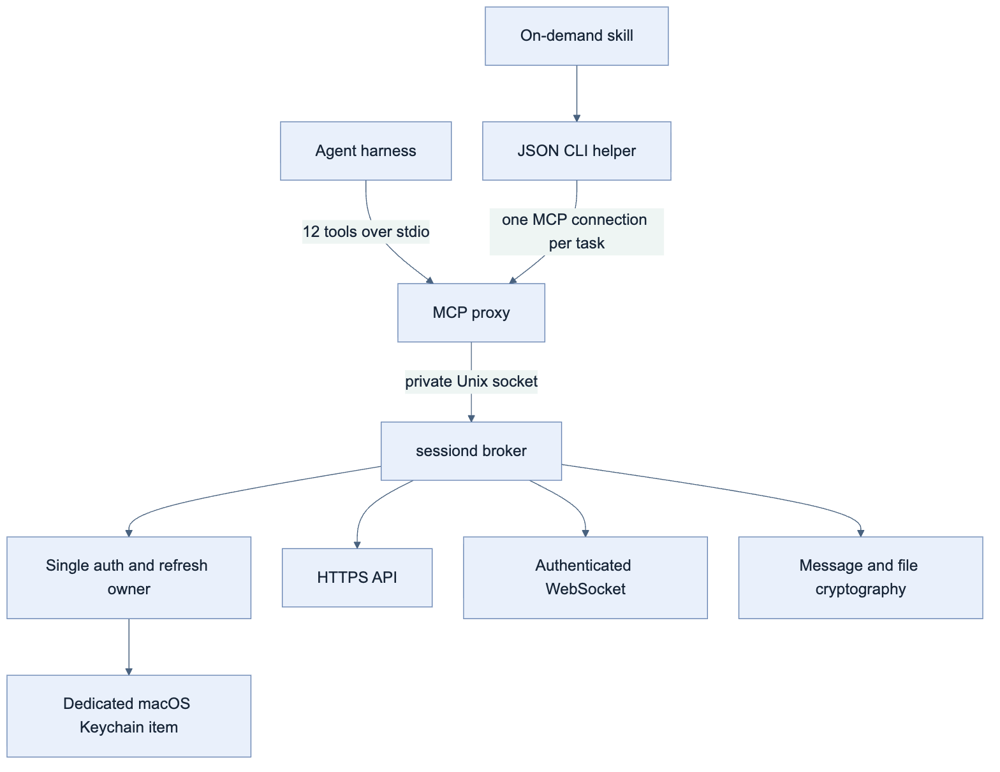
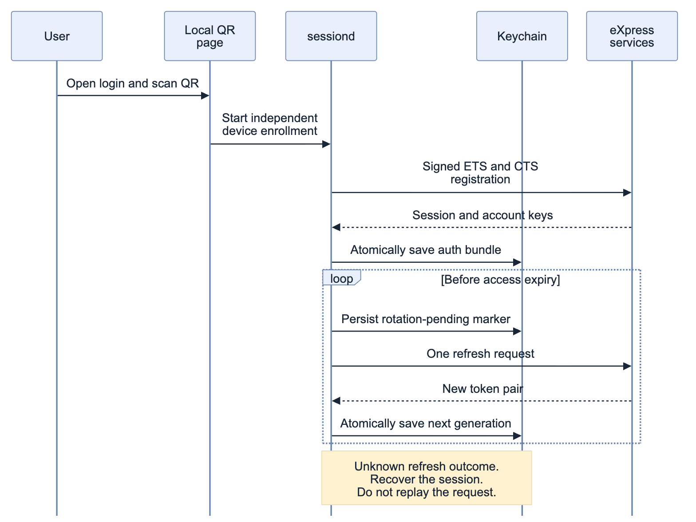

# express-mcp

An unofficial **eXpress messenger MCP server** for personal agents on macOS. Read chats and group threads, find people, send text or attachments, and download verified files. A persistent session broker owns authentication; short-lived agents connect over a private Unix socket.

**Start here:** [Install](#install-on-macos) → [Log in](#log-in) → [Connect your agent](#agent-harness-quick-guide).

## Architecture



- `sessiond` holds the only upstream connection and refresh writer. A native process lease prevents two local brokers from owning the same session.
- Tokens, keys, device identity and rotation generation live together in a dedicated Keychain item. The official app's credentials are never read. MCP returns content and sanitized diagnostics, not credentials.
- Each MCP caller has separate, short-lived confirmations and pagination cursors. Closing a connection discards that state; restarting an agent does not log out the broker.
- Origins are explicitly configured and HTTPS-validated. QR enrollment must match the configured CTS exactly. Redirects are rejected; custom trust roots can be supplied with `NODE_EXTRA_CA_CERTS` before installation.



## Install on macOS

Requires **Node.js 22+**, npm, an active macOS user login with an accessible login Keychain, and Xcode Command Line Tools (`xcode-select --install`). This release is source-installed; it is not published to npm. Linux and Windows session brokers are not supported.

```sh
git clone https://github.com/artdaal/express-mcp.git
cd express-mcp
npm ci
npm run build
```

Create a private JSON configuration outside this repository. Obtain the **exact CTS origin**, ETS origin, web origin and client package identifier from your deployment administrator. The values below are examples, not a working public service:

```json
{
  "ctsOrigin": "https://cts.chat.example.com",
  "etsOrigin": "https://ets.chat.example.com",
  "webOrigin": "https://chat.example.com",
  "appVersion": "3.66.47",
  "packageId": "com.example.express",
  "clientProfile": "express-cli-web"
}
```

```sh
node dist/src/cli.js configure < /absolute/private/deployment.json
node dist/src/cli.js install
```

`configure` writes an owner-only configuration under `~/Library/Application Support/express-mcp/`. `install` compiles the small Swift helpers, installs a user LaunchAgent and checks broker readiness. It creates a private rollback backup and **does not modify any agent harness configuration**. Re-run `install` after changing configuration or upgrading the checkout. Keep the checkout at a stable path.

## Log in

```sh
node dist/src/cli.js login
node dist/src/cli.js status
node dist/src/cli.js session-smoke
```

`login` opens a loopback-only QR page on the broker Mac. Scan it in the official mobile client and approve the device. The compatibility profile appears as **Chrome 149.0** on the phone; it does not launch a browser engine for API calls. A QR expires after two minutes; its local page offers renewal for ten minutes.

`status` reports local state. `session-smoke` performs an authenticated list and reads one recent message without sending anything; reads may mark a chat read. `authState:ready` alone is not an end-to-end test.

Enroll **each Mac separately**. Never clone a rotating refresh credential into two running brokers. Over SSH, the login page belongs to the remote Mac; use a trusted local port-forward/session to that Mac for enrollment, and ensure its user Keychain is available.

## Agent harness quick guide

Use absolute paths and the same macOS user as the broker. Replace `/absolute/express-mcp` below with your checkout. Restart or refresh the harness MCP session after changing its configuration.

### Codex

```sh
codex mcp add express -- /absolute/path/to/node /absolute/express-mcp/dist/src/cli.js serve
```

Equivalent `~/.codex/config.toml` entry:

```toml
[mcp_servers.express]
command = "/absolute/path/to/node"
args = ["/absolute/express-mcp/dist/src/cli.js", "serve"]
```

See [Codex MCP configuration](https://learn.chatgpt.com/docs/extend/mcp?surface=cli). Ask the agent to check `express_status`, then list or read a known chat.

### Claude Code and other MCP harnesses

```sh
claude mcp add --transport stdio --scope user express -- /absolute/path/to/node /absolute/express-mcp/dist/src/cli.js serve
```

See [Claude Code MCP configuration](https://code.claude.com/docs/en/mcp). Other harnesses can use this standard stdio configuration:

```json
{
  "mcpServers": {
    "express": {
      "command": "/absolute/path/to/node",
      "args": ["/absolute/express-mcp/dist/src/cli.js", "serve"]
    }
  }
}
```

### OpenClaw: load capabilities on demand

Install the skill only in the intended agent's workspace:

```sh
node scripts/install-skill.mjs --workspace /absolute/openclaw/workspace
```

The installer copies a real skill directory and records local executable paths. It adds **zero global MCP tools**. Only the skill's short discovery description is available by default; its instructions load when the agent selects it. Start a fresh agent session and ask, for example, “Find the Project chat in eXpress and summarize recent replies.” See [OpenClaw skill loading](https://docs.openclaw.ai/tools/skills).

The skill invokes a bounded JSON CLI. Preparation and sending share one MCP connection, avoiding confirmation failures caused by separate one-shot MCP invocations. A manual read-only check:

```sh
node dist/src/cli.js agent <<'JSON'
{"operation":"search-chats","query":"Project","limit":50,"pages":3}
JSON
```

Verify discovery with `openclaw skills --agent main info express-messenger --json` (replace `main` with your agent ID). If the directory is present but the running gateway still reports an old skill catalog, restart it with `openclaw gateway restart`, then start a fresh agent session.

The full request examples are in [the skill](skills/express-messenger/SKILL.md). The helper never automatically retries writes. `confirmed:true` is an explicit caller assertion that the user authorized the exact recipient and content; it is not an independent permission system. On updates, review and back up the existing skill before replacing it; the installer refuses to overwrite one silently.

## Capabilities and bounds

| Area | MCP tools (`express_` prefix) |
| --- | --- |
| Session and discovery | `status`, `list_chats`, `search_direct_chats`, `get_chat_info` |
| History | `read_chat`, `list_threads`, `read_thread` |
| Text | `prepare_message`, `send_message` |
| Files | `prepare_attachment`, `send_attachment`, `download_attachment` |

Text and attachments use exact-content, caller-bound, single-use confirmations valid for 120 seconds. Attachment preparation hashes the source; changing it invalidates confirmation. Uploads and message writes are never blindly retried after an uncertain response. Image uploads use an encrypted PNG original plus an encrypted JPEG preview. Downloads verify message signatures, secretstream integrity, plaintext size and hash, then save into a new private directory.

Current limits: 50 items per MCP page; CLI up to 20 pages and about 200 KiB of content; 10 MiB per attachment; PNG image uploads only; a bounded recent thread list; no global full-text search. Some historical messages may be undecryptable and are returned with an explicit error marker. This is an unofficial, version-sensitive protocol integration: deployment versions and policy may differ. The optional legacy DOM adapter is retained for regression work, not the recommended installation path.

## Maintenance

```sh
npm test
npm run typecheck
launchctl kickstart -k "gui/$(id -u)/io.github.express-mcp.express-sessiond"
# Restore the LaunchAgent from a private backup returned by install:
node scripts/install.mjs --restore /absolute/private/backup-directory
```

A locked Keychain needs local user action. A revoked session or ambiguous refresh requires a new QR; repeated retries do not repair it. Diagnose upstream errors with the sanitized phase/status in `status`. For an uncertain send, inspect the target history before deciding whether another send is appropriate. An upload may leave an orphaned encrypted file if message creation fails; automatic server-file cleanup is not implemented.

## Development and attribution

Tests cover QR request signatures, origin pinning, refresh races and recovery, IPC caller isolation, message cryptography, encrypted file round trips, bounded agent commands and package installation. Local `.agent/` evidence, credentials, browser profiles, generated binaries and test payloads are excluded from distribution.

[eXpress CLI by IH8E](https://github.com/IH8E/express-cli/tree/2e58b5fbf4cc2e65c9e689fffa05bffc791ddd90) was a protocol reference for the browser-compatible QR flow; it is not a runtime dependency, and its source is not distributed here. Test request fixtures use synthetic data. Refresh handling also follows the conservative principles in [RFC 9700 §4.14](https://www.rfc-editor.org/rfc/rfc9700.html#section-4.14).

MIT licensed. Not affiliated with or endorsed by the eXpress vendor.
